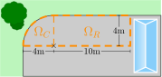

## Introduktion{-}
En virksomhed overvejer at opsætte solceller på en del af deres tag. Inden de tager beslutningen, ønsker de dog at estimere både prisen for at sætte anlægget op samt den effekt anlægget kan levere.
Modellerne og tallene i denne workshop kommer ikke fra et reelt solcelleanlæg, men er valgt så forskellige dele af beregningerne giver mening at lave både i hånden og i Python.
Det burde dog alligevel give et indblik i de beregninger, der kunne være relevante for at lave en sådan analyse.

Området, hvor solceller skal sættes op, har form som på @fig-tag. Vi kalder hele området $\Omega$, og inddeler det desuden i to mindre områder: $\Omega_C$ betegner den kvartcirkelformede del af $\Omega$, mens $\Omega_R$ betegner den rektangulære del.

Vi laver en forsimplet antagelse om, at arealet af tagområdet svarer præcist til arealet af solcellepanelerne. I praksis skal panelerne installeres i en bestemt vinkel og med en vis afstand mellem hver række, hvilket ændrer det præcise solcelleareal. Den simple model er dog tilstrækkelig til vores formål.

{#fig-tag width=70%}

## Delopgave 1{#sec-opg1}

1. Beregn først arealet af $\Omega$ ved at bruge de gængse arealformler for rektanglet og cirklen.

1. Opstil et dobbeltintegrale til at bestemme arealet af $\Omega_C$ på to forskellige måder: Et med polære koordinater og et med rektangulære koordinater.

1. Brug et dobbeltintegrale til at beregne arealet af $\Omega_R$, og læg det sammen med arealet af $\Omega_C$ fra ovenfor. Tjek, at I får det samme som jeres oprindelige arealberegning.

1. Solcelleanlægget er estimeret til at koste 2.500 per m&sup2;. Beregn den forventede pris.

## Delopgave 2{#sec-opg2}
Vi ønsker nu at estimere den samlede el-produktion, vi kan forvente fra det nye anlæg. På grund af solens retning og placeringen af andre bygninger omkring virksomheden, vil produktionen ikke være konstant på hele taget. Det vil i stedet afhænge af placeringen $(x,y)$. I denne workshop forestiller vi os, at el-produktionen kan modelleres fornuftigt med
$$f(x,y) = \alpha\big(\beta - 2x^2-y^2+2xy\big) \mathrm{W}/\mathrm{m}^2,$${#eq-model}
hvor $\alpha$ og $\beta$ afhænger af årstiden og den præcise solcellemodel.

(@) Brug først Python-koden herunder til at skitsere $f$ på virksomhedens tag. Giver alle værdier af $\alpha$ og $\beta$ mening?

```{pyodide-python}
import numpy
import matplotlib.pyplot as plt

alpha = 1/5
beta = 800

## Definer modellen f
def f(x,y):
	return alpha*(beta-2*x**2 - y**2 + 2*x*y)
	
## Definer evalueringspunkter (x,y)
xs = numpy.linspace(-4, 10, num=100)
ys = numpy.linspace(0, 4, num=100)
zs = numpy.empty([len(ys), len(xs)])

## Beregn funktionsværdien for evalueringspunkterne,
## men medtag kun værdien, hvis
for i, x in enumerate(xs):
	for j, y in enumerate(ys):
		if x<0 and x**2+y**2>4**2:
			zs[j,i] = float("NaN")
			continue
		zs[j,i] = f(x,y)

## Opsæt og vis plottet
plt.close("all") 
plot, ax = plt.subplots()
contour = ax.contourf(xs,ys,zs, levels=10)
ax.set_aspect("equal")
plt.colorbar(contour, label="$W/m^2$")
plt.show()
```

(@) Opstil et dobbeltintegrale til at beregne el-produktionen fra $\Omega_R$. Vis, at denne produktion er $\alpha(40\beta-2080)$.

For at bestemme produktionen fra $\Omega_C$, skifter vi til polære koordinater. Altså ønsker vi at bestemme en funktion $\tilde{f}$, så $\tilde{f}(r,\theta) = f\big(r\cos(\theta), r\sin(\theta)\big)$.

(@) Vis, at $\tilde{f}(r,\theta) = \alpha\bigg(\beta - r^2 \big(\frac{3}{2}+\frac{1}{2}\cos(2\theta)-\sin(2\theta)\big)\bigg)$.

    :::{.callout-tip title="Vink" collapse=true}
	Brug &lsquo;dobbeltvinkelformlerne&rsquo; $\sin(2\theta) = 2\cos(\theta)\sin(\theta)$ og $\cos(2\theta)=2\cos^2(\theta)-1$.
	:::
	
(@) Forklar, at produktionen fra $\Omega_C$ kan beregnes ved
$$\alpha\beta\int_{\frac{\pi}{2}}^\pi \int_0^4 r\,\mathrm{d}r\,\mathrm{d}\theta - \alpha\int_{\frac{\pi}{2}}^\pi \int_0^4 r^3\left(\frac{3}{2}+\frac{1}{2}\cos(2\theta)-\sin(2\theta)\right)\,\mathrm{d}r\,\mathrm{d}\theta.$${#eq-polar}

(@) Vis, at første led i @eq-polar er $4\pi\alpha\beta$.

(@) Beregn det inderste integrale i andet led i @eq-polar, og forklar, at resultatet kan omskrives til
$$-32\alpha\left(\int_{\frac{\pi}{2}}^\pi 3+ \cos(2\theta)\ - 2\sin(2\theta)\,\mathrm{d}\theta\right).$${#eq-omskrivIntegrale}

    Udregn integralet i @eq-omskrivIntegrale.
	
	:::{.callout-tip title="Vink" collapse=true}
	Brug f.eks. substitutionen $u=2\theta$.
	:::
	
(@) Konkludér fra delene ovenfor, at den samlede effekt fra de nye anlæg forventes at blive
$$\alpha\big((40+4\pi)\beta - 2144 - 48\pi\big).$$


## Delopgave 3{#sec-opg3}
Til sidst vil vi bruge Python til at estimere den samlede elproduktion i tidsrummet 7:00&ndash;19:00 på én bestemt dag.
Anlæggets effekt er ikke konstant i løbet af dagen, og vi indfører derfor variablen $t$, som beskriver antal timer efter 7:00. Den opdaterede model, der tager højde for tidspunktet på dagen er
$$f(x,y,t) = \alpha\sin\left(\frac{\pi t}{12}\right)\big(\beta - 2x^2 - s(t)^2y^2 + 2s(t)xy\big)\mathrm{W}/\mathrm{m}^2,$${#eq-modelOpdateret}
hvor $s(t)=\frac{1}{2}+\frac{t}{6}$ og $t\in [0,12]$.

1. Forklar betydningen af $\sin(\pi t/12)$ i @eq-modelOpdateret. Passer det nogenlunde med intuitionen om, hvordan solen rammer anlægget i løbet af dagen?

1. Argumenter for, at den samlede el-produktion i løbet af dagen er givet ved både
$$\iint_\Omega \int_0^{12} f(x,y,t)\,\mathrm{d}t\,\mathrm{d}A
\quad\text{og}\quad\int_0^{12} \iint_\Omega f(x,y,t)\,\mathrm{d}A\,\mathrm{d}t.$${#eq-tripelInt}
Forklar i ord, hvad forskellen er på de to integrationsrækkefølger. Altså, hvilken fysisk størrelse beskriver hvert integrale (og i hvilken enhed)?

1. Opskriv et tripel-integrale til at beregne @eq-modelOpdateret (I behøver ikke beregne det &ndash; det gør vi i Python).

1. Gennemgå kodestykket nedenunder, der plotter effekten af solcelleanlægget i løbet af dagen. Forklar sammenhængen mellem plottet og ét af de to udtryk i @eq-tripelInt.

   ```{pyodide-python}
   import numpy
   import matplotlib.pyplot as plt
   from numpy import sin, pi
   from scipy.integrate import dblquad
   
   alpha = 1/5
   beta = 800
   
   def s(t):
   	return 1/2 + t/6
   
   ## Bemærk, at vi har ændret variablenes rækkefølge, for at det passer
   ## med den måde dblquad og tplquad forventer det.
   def f(t, y, x):
   	return alpha*sin(pi*t/12)*(beta - 2*x**2 - (s(t)*y)**2 + 2*s(t)*x*y)
   	
   def yLower(x):
   	return 0
   	
   def yUpper(x):
   	if x>=0:
   		return 4
   	return numpy.sqrt(16-x**2)
   
   ts = numpy.linspace(0, 12, num=20)
   effekt = [ dblquad(lambda y,x: f(t,y,x), -4, 10, yLower, yUpper)[0] for t in ts ]
   
   plot, ax = plt.subplots()
   ax.plot(ts, effekt)
   ax.set_xlabel("t")
   ax.set_ylabel("W")
   plt.show()
   ```
1. Til sidst vil vi udregne udtrykket i @eq-tripelInt numerisk. Her kan vi bruge funktionen `tplquad` fra Scipy (&lsquo;tpl&rsquo; er en forkortelse af &lsquo;triple&rsquo;, mens &lsquo;dbl&rsquo; fra før er en forkortelse af &lsquo;double&rsquo;). For at beregne tripelintegralet
$$\int_{x_0}^{x_1} \int_{g_0(x)}^{g_1(x)} \int_{t_0}^{t_1} f(t,y,x)\,\mathrm{d}t\,\mathrm{d}y\,\mathrm{d}x$$
skal Python-funktionen kaldes som `tplquad(f, x₀, x₁, g₀, g₁, t₀, t₁)`.

   Færdiggør kodeblokken herunder for at regne den samlede produktion i løbet af dagen.

   ```{pyodide-python}
   from scipy.integrate import tplquad
   produktion = tplquad(???)
   print("Samlet produktion: {:.2f} kWh".format(produktion[0]/1e3))
   ```

<!-- Local Variables: -->
<!-- ispell-local-dictionary: "da_DK" -->
<!-- End: -->
