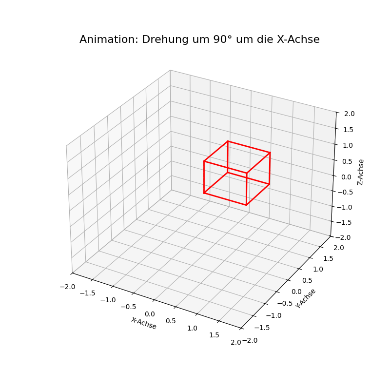
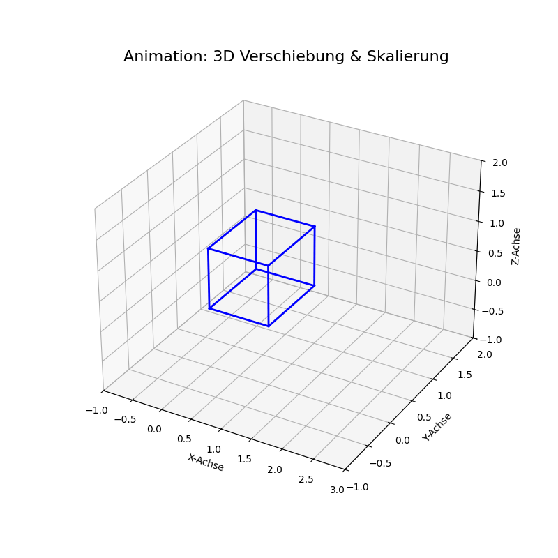
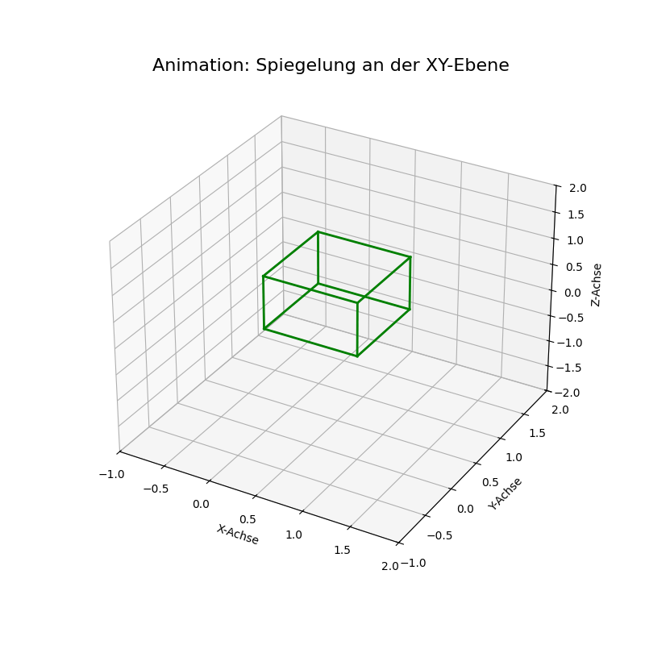

:::: {.content-visible when-profile="deutsch"}

::: {.callout-note title="Zellen der Reihe nach ausführen"}
Die Code-Zellen dieser Seite bauen aufeinander auf: Importe, Variablen und Funktionen aus einer Zelle gelten auch in allen späteren Zellen und werden dort nicht wiederholt. Führe die Zellen deshalb von oben nach unten aus. Bei Reitern gilt dieselbe Reihenfolge von links nach rechts. Meldet Python einen `NameError`, hast du meist eine frühere Zelle noch nicht ausgeführt.
:::

Nachdem die Grundlagen in den letzten Kapiteln behandelt wurden, geht es in diesem Unterkapitel um den vielleicht wichtigsten Vorteil von Python: die **Visualisierung**.

Eine Liste von Koordinaten vor und nach einer Transformation zu sehen ist nützlich, aber erst die grafische Darstellung macht wirklich intuitiv verständlich, was eine Skalierung, Rotation oder Verschiebung bewirkt.  
Zuerst bearbeitest du selbst statische Vorher-Nachher-Vergleiche. Am Ende der Seite gibt es außerdem Animationen in 3D, deren Code du direkt hier im Browser ausführen und verändern kannst.


# 5.3.1. Grundlegende Visualisierung: Vorher-Nachher-Vergleich

Die einfachste Methode, eine Transformation zu visualisieren, ist die Gegenüberstellung der ursprünglichen Form und der transformierten Form. Dafür eignet sich die Python-Bibliothek `Matplotlib` hervorragend, natürlich in Verbindung mit `numpy`.

Wichtig ist hierbei ein Gedanke, den wir im nächsten Kapitel weiterverfolgen: Wir wollen nicht nur einzelne Punkte transformieren, sondern eine **geometrische Form**. Ein Quadrat wird durch vier Eckpunkte definiert, ist aber erst als Form erkennbar, wenn wir die Linien zwischen diesen Punkten ziehen.

Schauen wir uns das an einem Beispiel an. Wir definieren ein Quadrat, wenden eine Transformation an und plotten beide nebeneinander.

## Beispiel-Transformationen

Im Folgenden findest du verschiedene geometrische Transformationen. Die "Verschiebung" ist als vollständiges Beispiel implementiert. Nutze diesen Code als Vorlage, um die Aufgaben für "Rotation" und "Spiegelung" zu lösen!

::: {.panel-tabset}

### Verschiebung (Beispiel)

Wenn du diesen Code ausführst, siehst du zwei Koordinatensysteme, in einem das ursprüngliche Quadrat, in einem das verschobene Quadrat.

```{pyodide-python}
import numpy as np
import matplotlib.pyplot as plt

# Definiere die Eckpunkte des Quadrats
# Der letzte Punkt ist identisch zum ersten, um die Form zu schließen
Eckpunkte_des_Quadrats = np.array([[0,0], [1,0], [1,1], [0,1], [0,0]])

# Hilfsfunktion zum Zeichnen, um Code-Wiederholung zu vermeiden
def zeichne_plot(ax, punkte, titel, farbe):
    """Zeichnet eine Form und konfiguriert den Plot."""
    ax.plot(punkte[:,0], punkte[:,1], color=farbe, marker='o')
    ax.set_title(titel)
    ax.axis('equal')
    ax.set_xlim(-2, 3)
    ax.set_ylim(-2, 3)
    ax.grid(True)
    ax.axhline(0, color='black', linewidth=0.5)
    ax.axvline(0, color='black', linewidth=0.5)

# Transformationsparameter
verschiebungsvektor = np.array([0.5, 1])

# Transformation anwenden
verschobene_punkte = Eckpunkte_des_Quadrats + verschiebungsvektor

# Plots erstellen
fig, (ax1, ax2) = plt.subplots(1, 2, figsize=(10, 5))

zeichne_plot(ax1, Eckpunkte_des_Quadrats, 'Ursprüngliches Quadrat', 'blue')
zeichne_plot(ax2, verschobene_punkte, f'Quadrat verschoben um {verschiebungsvektor}', 'red')

plt.show()
```

### Rotation (Aufgabe)

**Aufgabe**: Rotiere das Quadrat um 45 Grad um den Ursprung.

*   Definiere den Drehwinkel und wandle ihn ins Bogenmaß um.
*   Erstelle eine 2D-Rotationsmatrix.
*   Wende die Matrix auf die Eckpunkte an (Achtung: Matrizenmultiplikation!).
*   Visualisiere das Ergebnis.

**Befehle, die du brauchst:** `np.deg2rad()`, `np.cos()`, `np.sin()`, `np.array()`, der Operator `@` und `.T`, `plt.subplots()`, `plt.show()`, dazu aus dem Reiter „Verschiebung“ das Quadrat `Eckpunkte_des_Quadrats` und die Hilfsfunktion `zeichne_plot()`.

```{pyodide-python}
#| label: visualisierung-rotation
# Dein Code hier
```

### Spiegelung (Aufgabe)

**Aufgabe**: Spiegle das Quadrat an der y-Achse.

*   Erstelle eine Spiegelungsmatrix für die Spiegelung an der y-Achse.
*   Wende die Matrix auf die Eckpunkte an.
*   Visualisiere das Ergebnis.

**Befehle, die du brauchst:** `np.array()`, der Operator `@` und `.T`, `plt.subplots()`, `plt.show()`, dazu aus dem Reiter „Verschiebung“ das Quadrat `Eckpunkte_des_Quadrats` und die Hilfsfunktion `zeichne_plot()`.

```{pyodide-python}
#| label: visualisierung-spiegelung
# Dein Code hier
```

:::

<details>
<summary>Mögliche Lösungen für die Aufgaben</summary>

Hier findest du den Code, der alle drei 2D-Transformationen (Verschiebung, Rotation, Spiegelung) zusammenführt und visualisiert. Er verwendet die Importe und das Quadrat `Eckpunkte_des_Quadrats` aus dem Beispiel im Reiter „Verschiebung“; führe jene Zelle also zuerst aus.


```{pyodide-python}
# Hilfsfunktion zum Zeichnen, um Code-Wiederholung zu vermeiden
def zeichne_plot(ax, punkte, titel, farbe, original_punkte=None):
    """Zeichnet eine Form und konfiguriert den Plot."""
    if original_punkte is not None:
        ax.plot(original_punkte[:,0], original_punkte[:,1], color='gray', linestyle='--', label='Original')
    ax.plot(punkte[:,0], punkte[:,1], color=farbe, marker='o', label='Transformiert')
    ax.set_title(titel)
    ax.axis('equal')
    ax.set_xlim(-2, 3)
    ax.set_ylim(-2, 3)
    ax.grid(True)
    ax.axhline(0, color='black', linewidth=0.5)
    ax.axvline(0, color='black', linewidth=0.5)
    ax.legend()

# 2. Transformationsmatrizen und -vektoren definieren

# Rotationsmatrix für 2D
def rotationsmatrix(alpha):
    c = np.cos(alpha)
    s = np.sin(alpha)
    return np.array([[c, -s], [s, c]])

# Spiegelungsmatrix für Spiegelung an der y-Achse
def spiegelungsmatrix_y_achse():
    return np.array([[-1, 0], [0, 1]])

drehwinkel_grad = 45
alpha = np.deg2rad(drehwinkel_grad)

# 3. Transformationen anwenden

# Verschiebung
verschobene_punkte = Eckpunkte_des_Quadrats + verschiebungsvektor

# Rotation
# Beachte: Wenn Eckpunkte als (N, 2) Matrix (N Zeilen, 2 Spalten) vorliegen,
# und die Rotationsmatrix R als (2, 2) für Spaltenvektoren (x,y) definiert ist,
# dann ist die Multiplikation R @ Punkte.T und dann wieder .T,
# oder einfacher: Punkte @ R.T
gedrehte_punkte = Eckpunkte_des_Quadrats @ rotationsmatrix(alpha).T

# Spiegelung an der y-Achse
gespiegelte_punkte = Eckpunkte_des_Quadrats @ spiegelungsmatrix_y_achse().T

# 4. Visualisierung aller Transformationen in einer Figur
fig, axes = plt.subplots(2, 2, figsize=(12, 10))

# Originales Quadrat
zeichne_plot(axes[0, 0], Eckpunkte_des_Quadrats, 'Ursprüngliches Quadrat', 'blue')

# Verschiebung
zeichne_plot(axes[0, 1], verschobene_punkte, f'Verschiebung um {verschiebungsvektor}', 'red', Eckpunkte_des_Quadrats)

# Rotation
zeichne_plot(axes[1, 0], gedrehte_punkte, f'Rotation um {drehwinkel_grad}°', 'green', Eckpunkte_des_Quadrats)

# Spiegelung
zeichne_plot(axes[1, 1], gespiegelte_punkte, 'Spiegelung an der y-Achse', 'purple', Eckpunkte_des_Quadrats)

plt.tight_layout() # Passt die Subplots an, um Überlappungen zu vermeiden
plt.show()
```
</details>

## Beispiel 3-dimensionale Anwendung einer Rotationsmatrix visualisieren

Mit `matplotlib.animation` lassen sich Transformationen auch als Animation zeigen. Unten findest du drei 3D-Animationen, jeweils als fertiges GIF und mit dem Python-Code, der sie erzeugt. Der Code läuft **genauso wie in einer lokalen Python-Installation auch hier im Browser**: `plt.show()` erzeugt aus der Animation einen kleinen Player mit Start-, Stopp- und Geschwindigkeitsknöpfen. Das Berechnen der Bilder dauert ein paar Sekunden.

Die Animationen verwenden `np` und `plt` aus der ersten Code-Zelle dieser Seite (Beispiel „Verschiebung“). Führe sie vorher einmal aus.

Ändere zum Beispiel die Drehachse (`axis_to_rotate`), den Winkel oder die Spiegelebene und schau dir an, wie sich die Matrix auf den Würfel auswirkt.

:::{.callout-tip title="Geschwindigkeit: `interval`, nicht `frames`" collapse="true"}
`interval` ist der Abstand zwischen zwei Bildern in Millisekunden (hier 50 ms, also 20 Bilder pro Sekunde). `frames` bestimmt nur, *wie viele* Bilder berechnet werden. Mehr Bilder machen die Animation länger und die Berechnung langsamer, aber nicht flüssiger.
:::

::: {.panel-tabset}

### Rotation

{#fig-wuerfel-rotation}

<details>
<summary>Der Code zur Animation (hier ausführbar)</summary>

Probiere auch andere Winkel und Drehachsen aus und sieh direkt, wie Rotationsmatrizen sich auf 3-dimensionale Gebilde auswirken.

```{pyodide-python}
#| label: animation-rotation
import matplotlib.animation as animation
from mpl_toolkits.mplot3d import Axes3D

def rotation_matrix(axis, angle):
    """ Erzeugt eine Rotationsmatrix für eine Drehung um eine gegebene Achse. """
    c = np.cos(angle)
    s = np.sin(angle)

    if axis.lower() == 'x':
        return np.array([[1, 0, 0], [0, c, -s], [0, s, c]])
    elif axis.lower() == 'y':
        return np.array([[c, 0, s], [0, 1, 0], [-s, 0, c]])
    elif axis.lower() == 'z':
        return np.array([[c, -s, 0], [s, c, 0], [0, 0, 1]])
    else:
        raise ValueError("Achse muss 'x', 'y' oder 'z' sein")

cube_points = np.array([
    [0,1,1,0,0,1,1,0], [0,0,1,1,0,0,1,1], [0,0,0,0,1,1,1,1]
])

fig = plt.figure(figsize=(8, 8))
ax = fig.add_subplot(projection='3d')

edges = [[0,1], [1,2], [2,3], [3,0], [4,5], [5,6], [6,7], [7,4], [0,4], [1,5], [2,6], [3,7]]

axis_to_rotate = 'x'
target_angle_deg = 90

def update(angle):
    ax.cla()
    for kante in edges:
        p1, p2 = cube_points[:,kante[0]], cube_points[:,kante[1]]
        ax.plot3D([p1[0], p2[0]], [p1[1], p2[1]], [p1[2], p2[2]], color='gray', linestyle='--')

    rotated_points = rotation_matrix(axis_to_rotate, angle) @ cube_points

    for kante in edges:
        p1, p2 = rotated_points[:,kante[0]], rotated_points[:,kante[1]]
        ax.plot3D([p1[0], p2[0]], [p1[1], p2[1]], [p1[2], p2[2]], color='r', linewidth=2)

    ax.set_title(f'Animation: Drehung um {target_angle_deg}° um die {axis_to_rotate.upper()}-Achse')
    ax.set_xlabel('X-Achse'); ax.set_ylabel('Y-Achse'); ax.set_zlabel('Z-Achse')
    ax.set_xlim([-2, 2]); ax.set_ylim([-2, 2]); ax.set_zlim([-2, 2])

ani = animation.FuncAnimation(fig, update, frames=np.linspace(0, np.deg2rad(target_angle_deg), 60), interval=50, repeat=False)
plt.show()
```

</details>

### Verschiebung & Skalierung

{#fig-wuerfel-verschiebung}

<details>

<summary>Der Code zur Animation (hier ausführbar)</summary>

```{pyodide-python}
#| label: animation-verschiebung
import matplotlib.animation as animation

cube_points = np.array([
    [0,1,1,0,0,1,1,0], 
    [0,0,1,1,0,0,1,1], 
    [0,0,0,0,1,1,1,1]  
])

fig = plt.figure(figsize=(8, 8))
ax = fig.add_subplot(111, projection='3d')

edges = [
    [0,1], [1,2], [2,3], [3,0],
    [4,5], [5,6], [6,7], [7,4],
    [0,4], [1,5], [2,6], [3,7]  
]

translation_vector = np.array([1.5, 0.5, 0.5]) # Vektor um den verschoben wird
scale_factor = 1.5 # Zielfaktor für die Skalierung
num_frames = 60 # Anzahl der Frames für die Animation

def update_transform(frame_idx):
    """Aktualisiert die Position des Würfels für jeden Frame."""
    ax.cla()
    progress = frame_idx / (num_frames - 1)
    current_translation = translation_vector * progress
    current_scale = 1.0 + (scale_factor - 1.0) * progress

    cube_center = np.array([0.5, 0.5, 0.5])
    centered_points = cube_points - cube_center[:, np.newaxis]
    scaled_points = centered_points * current_scale
    transformed_points = scaled_points + cube_center[:, np.newaxis] + current_translation[:, np.newaxis]

    for edge in edges:
        p1, p2 = cube_points[:, edge[0]], cube_points[:, edge[1]]
        ax.plot3D([p1[0], p2[0]], [p1[1], p2[1]], [p1[2], p2[2]], color='gray', linestyle='--', alpha=0.5)

    for edge in edges:
        p1, p2 = transformed_points[:, edge[0]], transformed_points[:, edge[1]]
        ax.plot3D([p1[0], p2[0]], [p1[1], p2[1]], [p1[2], p2[2]], color='b', linewidth=2)

    ax.set_title('Animation: 3D Verschiebung & Skalierung')
    ax.set_xlabel('X-Achse'); ax.set_ylabel('Y-Achse'); ax.set_zlabel('Z-Achse')
    ax.set_xlim([-1, 3]); ax.set_ylim([-1, 2]); ax.set_zlim([-1, 2])

ani = animation.FuncAnimation(fig, update_transform, frames=num_frames, interval=50, repeat=False)
plt.show()
```

</details>

### Spiegelung

{#fig-wuerfel-spiegelung}

<details>
<summary>Der Code zur Animation (hier ausführbar)</summary>

```{pyodide-python}
#| label: animation-spiegelung
import matplotlib.animation as animation

cube_points = np.array([
    [0,1,1,0,0,1,1,0], 
    [0,0,1,1,0,0,1,1], 
    [0,0,0,0,1,1,1,1]  
])

fig = plt.figure(figsize=(8, 8))
ax = fig.add_subplot(111, projection='3d')

edges = [
    [0,1], [1,2], [2,3], [3,0], 
    [4,5], [5,6], [6,7], [7,4], 
    [0,4], [1,5], [2,6], [3,7]  
]

reflection_plane = 'xy' # Spiegele an der XY-Ebene (Z-Koordinaten ändern das Vorzeichen)
num_frames_reflection = 60

reflected_cube_points = np.copy(cube_points)
if reflection_plane == 'xy': reflected_cube_points[2, :] *= -1
elif reflection_plane == 'yz': reflected_cube_points[0, :] *= -1
elif reflection_plane == 'xz': reflected_cube_points[1, :] *= -1
else: raise ValueError("Reflexionsebene muss 'xy', 'yz' oder 'xz' sein")

def update_reflection(frame_idx):
    ax.cla()
    t = frame_idx / (num_frames_reflection - 1)
    interpolated_points = cube_points * (1 - t) + reflected_cube_points * t

    for edge in edges:
        p1, p2 = cube_points[:, edge[0]], cube_points[:, edge[1]]
        ax.plot3D([p1[0], p2[0]], [p1[1], p2[1]], [p1[2], p2[2]], color='gray', linestyle='--', alpha=0.5)

    for edge in edges:
        p1, p2 = interpolated_points[:, edge[0]], interpolated_points[:, edge[1]]
        ax.plot3D([p1[0], p2[0]], [p1[1], p2[1]], [p1[2], p2[2]], color='g', linewidth=2)

    ax.set_title(f'Animation: Spiegelung an der {reflection_plane.upper()}-Ebene')
    ax.set_xlabel('X-Achse'); ax.set_ylabel('Y-Achse'); ax.set_zlabel('Z-Achse')
    ax.set_xlim([-1, 2]); ax.set_ylim([-1, 2]); ax.set_zlim([-2, 2])

ani = animation.FuncAnimation(fig, update_reflection, frames=num_frames_reflection, interval=50, repeat=False)
plt.show()
```
</details>

:::

::::

:::: {.content-visible when-profile="english"}

::: {.callout-note title="Run the cells in order"}
The code cells on this page build on each other: imports, variables and functions from one cell are also available in all later cells and are not repeated there. So run the cells from top to bottom. For tabs, the same order applies from left to right. If Python reports a `NameError`, you most likely have not run an earlier cell yet.
:::

After the basics were covered in the last chapters, this subchapter is about perhaps the most important advantage of Python: **visualization**.

Seeing a list of coordinates before and after a transformation is useful, but only the graphical representation makes it truly intuitive what a scaling, rotation or translation does.  
First you will work on static before-and-after comparisons yourself. At the end of the page there are also 3D animations whose code you can run and change right here in the browser.


# 5.3.1. Basic visualization: before-and-after comparison {#grundlegende-visualisierung-vorher-nachher-vergleich}

The simplest way to visualize a transformation is to compare the original shape with the transformed shape. The Python library `Matplotlib` is excellent for this, in combination with `numpy` of course.

An important idea here, which we will follow up in the next chapter: we do not only want to transform individual points but a **geometric shape**. A square is defined by four corner points, but it only becomes recognizable as a shape when we draw the lines between these points.

Let's look at an example. We define a square, apply a transformation and plot both side by side.

## Example transformations {#beispiel-transformationen}

Below you will find different geometric transformations. The "translation" is implemented as a complete example. Use this code as a template to solve the exercises for "rotation" and "reflection"!

::: {.panel-tabset}

### Translation (example)

When you run this code, you see two coordinate systems, one with the original square and one with the shifted square.

```{pyodide-python}
import numpy as np
import matplotlib.pyplot as plt

# Define the corner points of the square
# The last point is identical to the first to close the shape
square_corners = np.array([[0,0], [1,0], [1,1], [0,1], [0,0]])

# Helper function for drawing, to avoid repeating code
def draw_plot(ax, points, title, color):
    """Draws a shape and configures the plot."""
    ax.plot(points[:,0], points[:,1], color=color, marker='o')
    ax.set_title(title)
    ax.axis('equal')
    ax.set_xlim(-2, 3)
    ax.set_ylim(-2, 3)
    ax.grid(True)
    ax.axhline(0, color='black', linewidth=0.5)
    ax.axvline(0, color='black', linewidth=0.5)

# Transformation parameters
translation_vector = np.array([0.5, 1])

# Apply the transformation
shifted_points = square_corners + translation_vector

# Create the plots
fig, (ax1, ax2) = plt.subplots(1, 2, figsize=(10, 5))

draw_plot(ax1, square_corners, 'Original square', 'blue')
draw_plot(ax2, shifted_points, f'Square shifted by {translation_vector}', 'red')

plt.show()
```

### Rotation (exercise)

**Exercise**: Rotate the square by 45 degrees about the origin.

*   Define the angle of rotation and convert it to radians.
*   Create a 2D rotation matrix.
*   Apply the matrix to the corner points (careful: matrix multiplication!).
*   Visualize the result.

**Commands you need:** `np.deg2rad()`, `np.cos()`, `np.sin()`, `np.array()`, the operator `@` and `.T`, `plt.subplots()`, `plt.show()`, plus the square `square_corners` and the helper function `draw_plot()` from the "Translation" tab.

```{pyodide-python}
#| label: visualisierung-rotation-en
# Your code here
```

### Reflection (exercise)

**Exercise**: Reflect the square across the y-axis.

*   Create a reflection matrix for the reflection across the y-axis.
*   Apply the matrix to the corner points.
*   Visualize the result.

**Commands you need:** `np.array()`, the operator `@` and `.T`, `plt.subplots()`, `plt.show()`, plus the square `square_corners` and the helper function `draw_plot()` from the "Translation" tab.

```{pyodide-python}
#| label: visualisierung-spiegelung-en
# Your code here
```

:::

<details>
<summary>Possible solutions to the exercises</summary>

Here you will find the code that combines and visualizes all three 2D transformations (translation, rotation, reflection). It uses the imports and the square `square_corners` from the example in the "Translation" tab, so run that cell first.


```{pyodide-python}
# Helper function for drawing, to avoid repeating code
def draw_plot(ax, points, title, color, original_points=None):
    """Draws a shape and configures the plot."""
    if original_points is not None:
        ax.plot(original_points[:,0], original_points[:,1], color='gray', linestyle='--', label='Original')
    ax.plot(points[:,0], points[:,1], color=color, marker='o', label='Transformed')
    ax.set_title(title)
    ax.axis('equal')
    ax.set_xlim(-2, 3)
    ax.set_ylim(-2, 3)
    ax.grid(True)
    ax.axhline(0, color='black', linewidth=0.5)
    ax.axvline(0, color='black', linewidth=0.5)
    ax.legend()

# 2. Define transformation matrices and vectors

# Rotation matrix for 2D
def rotation_matrix(alpha):
    c = np.cos(alpha)
    s = np.sin(alpha)
    return np.array([[c, -s], [s, c]])

# Reflection matrix for the reflection across the y-axis
def reflection_matrix_y_axis():
    return np.array([[-1, 0], [0, 1]])

angle_deg = 45
alpha = np.deg2rad(angle_deg)

# 3. Apply the transformations

# Translation
shifted_points = square_corners + translation_vector

# Rotation
# Note: if the corner points are given as an (N, 2) matrix (N rows, 2 columns)
# and the rotation matrix R is defined as (2, 2) for column vectors (x,y),
# then the multiplication is R @ points.T and then .T again,
# or more simply: points @ R.T
rotated_points = square_corners @ rotation_matrix(alpha).T

# Reflection across the y-axis
reflected_points = square_corners @ reflection_matrix_y_axis().T

# 4. Visualize all transformations in one figure
fig, axes = plt.subplots(2, 2, figsize=(12, 10))

# Original square
draw_plot(axes[0, 0], square_corners, 'Original square', 'blue')

# Translation
draw_plot(axes[0, 1], shifted_points, f'Translation by {translation_vector}', 'red', square_corners)

# Rotation
draw_plot(axes[1, 0], rotated_points, f'Rotation by {angle_deg}°', 'green', square_corners)

# Reflection
draw_plot(axes[1, 1], reflected_points, 'Reflection across the y-axis', 'purple', square_corners)

plt.tight_layout() # adjusts the subplots to avoid overlaps
plt.show()
```
</details>

## Example: visualizing the 3-dimensional application of a rotation matrix {#beispiel-3-dimensionale-anwendung-einer-rotationsmatrix-visualisieren}

With `matplotlib.animation`, transformations can also be shown as an animation. Below you will find three 3D animations, each as a finished GIF and with the Python code that creates it. The code runs **here in the browser just as it would in a local Python installation**: `plt.show()` turns the animation into a small player with start, stop and speed buttons. Computing the frames takes a few seconds.

The animations use `np` and `plt` from the first code cell on this page (the "Translation" example). Run it once beforehand.

For example, change the axis of rotation (`axis_to_rotate`), the angle or the reflection plane and see how the matrix affects the cube.

:::{.callout-tip title="Speed: `interval`, not `frames`" collapse="true"}
`interval` is the gap between two frames in milliseconds (50 ms here, i.e. 20 frames per second). `frames` only determines *how many* frames are computed. More frames make the animation longer and the computation slower, but not smoother.
:::

::: {.panel-tabset}

### Rotation

{#fig-wuerfel-rotation-en}

<details>
<summary>The code for the animation (runs here)</summary>

Also try other angles and axes of rotation and see directly how rotation matrices affect 3-dimensional objects.

```{pyodide-python}
#| label: animation-rotation-en
import matplotlib.animation as animation
from mpl_toolkits.mplot3d import Axes3D

def rotation_matrix(axis, angle):
    """ Creates a rotation matrix for a rotation about a given axis. """
    c = np.cos(angle)
    s = np.sin(angle)

    if axis.lower() == 'x':
        return np.array([[1, 0, 0], [0, c, -s], [0, s, c]])
    elif axis.lower() == 'y':
        return np.array([[c, 0, s], [0, 1, 0], [-s, 0, c]])
    elif axis.lower() == 'z':
        return np.array([[c, -s, 0], [s, c, 0], [0, 0, 1]])
    else:
        raise ValueError("Axis must be 'x', 'y' or 'z'")

cube_points = np.array([
    [0,1,1,0,0,1,1,0], [0,0,1,1,0,0,1,1], [0,0,0,0,1,1,1,1]
])

fig = plt.figure(figsize=(8, 8))
ax = fig.add_subplot(projection='3d')

edges = [[0,1], [1,2], [2,3], [3,0], [4,5], [5,6], [6,7], [7,4], [0,4], [1,5], [2,6], [3,7]]

axis_to_rotate = 'x'
target_angle_deg = 90

def update(angle):
    ax.cla()
    for edge in edges:
        p1, p2 = cube_points[:,edge[0]], cube_points[:,edge[1]]
        ax.plot3D([p1[0], p2[0]], [p1[1], p2[1]], [p1[2], p2[2]], color='gray', linestyle='--')

    rotated_points = rotation_matrix(axis_to_rotate, angle) @ cube_points

    for edge in edges:
        p1, p2 = rotated_points[:,edge[0]], rotated_points[:,edge[1]]
        ax.plot3D([p1[0], p2[0]], [p1[1], p2[1]], [p1[2], p2[2]], color='r', linewidth=2)

    ax.set_title(f'Animation: rotation by {target_angle_deg}° about the {axis_to_rotate.upper()}-axis')
    ax.set_xlabel('X-axis'); ax.set_ylabel('Y-axis'); ax.set_zlabel('Z-axis')
    ax.set_xlim([-2, 2]); ax.set_ylim([-2, 2]); ax.set_zlim([-2, 2])

ani = animation.FuncAnimation(fig, update, frames=np.linspace(0, np.deg2rad(target_angle_deg), 60), interval=50, repeat=False)
plt.show()
```

</details>

### Translation & scaling

{#fig-wuerfel-verschiebung-en}

<details>

<summary>The code for the animation (runs here)</summary>

```{pyodide-python}
#| label: animation-verschiebung-en
import matplotlib.animation as animation

cube_points = np.array([
    [0,1,1,0,0,1,1,0], 
    [0,0,1,1,0,0,1,1], 
    [0,0,0,0,1,1,1,1]  
])

fig = plt.figure(figsize=(8, 8))
ax = fig.add_subplot(111, projection='3d')

edges = [
    [0,1], [1,2], [2,3], [3,0],
    [4,5], [5,6], [6,7], [7,4],
    [0,4], [1,5], [2,6], [3,7]  
]

translation_vector = np.array([1.5, 0.5, 0.5]) # vector to shift by
scale_factor = 1.5 # target factor for the scaling
num_frames = 60 # number of frames for the animation

def update_transform(frame_idx):
    """Updates the position of the cube for every frame."""
    ax.cla()
    progress = frame_idx / (num_frames - 1)
    current_translation = translation_vector * progress
    current_scale = 1.0 + (scale_factor - 1.0) * progress

    cube_center = np.array([0.5, 0.5, 0.5])
    centered_points = cube_points - cube_center[:, np.newaxis]
    scaled_points = centered_points * current_scale
    transformed_points = scaled_points + cube_center[:, np.newaxis] + current_translation[:, np.newaxis]

    for edge in edges:
        p1, p2 = cube_points[:, edge[0]], cube_points[:, edge[1]]
        ax.plot3D([p1[0], p2[0]], [p1[1], p2[1]], [p1[2], p2[2]], color='gray', linestyle='--', alpha=0.5)

    for edge in edges:
        p1, p2 = transformed_points[:, edge[0]], transformed_points[:, edge[1]]
        ax.plot3D([p1[0], p2[0]], [p1[1], p2[1]], [p1[2], p2[2]], color='b', linewidth=2)

    ax.set_title('Animation: 3D translation & scaling')
    ax.set_xlabel('X-axis'); ax.set_ylabel('Y-axis'); ax.set_zlabel('Z-axis')
    ax.set_xlim([-1, 3]); ax.set_ylim([-1, 2]); ax.set_zlim([-1, 2])

ani = animation.FuncAnimation(fig, update_transform, frames=num_frames, interval=50, repeat=False)
plt.show()
```

</details>

### Reflection

{#fig-wuerfel-spiegelung-en}

<details>
<summary>The code for the animation (runs here)</summary>

```{pyodide-python}
#| label: animation-spiegelung-en
import matplotlib.animation as animation

cube_points = np.array([
    [0,1,1,0,0,1,1,0], 
    [0,0,1,1,0,0,1,1], 
    [0,0,0,0,1,1,1,1]  
])

fig = plt.figure(figsize=(8, 8))
ax = fig.add_subplot(111, projection='3d')

edges = [
    [0,1], [1,2], [2,3], [3,0], 
    [4,5], [5,6], [6,7], [7,4], 
    [0,4], [1,5], [2,6], [3,7]  
]

reflection_plane = 'xy' # reflect across the XY plane (Z-coordinates change sign)
num_frames_reflection = 60

reflected_cube_points = np.copy(cube_points)
if reflection_plane == 'xy': reflected_cube_points[2, :] *= -1
elif reflection_plane == 'yz': reflected_cube_points[0, :] *= -1
elif reflection_plane == 'xz': reflected_cube_points[1, :] *= -1
else: raise ValueError("Reflection plane must be 'xy', 'yz' or 'xz'")

def update_reflection(frame_idx):
    ax.cla()
    t = frame_idx / (num_frames_reflection - 1)
    interpolated_points = cube_points * (1 - t) + reflected_cube_points * t

    for edge in edges:
        p1, p2 = cube_points[:, edge[0]], cube_points[:, edge[1]]
        ax.plot3D([p1[0], p2[0]], [p1[1], p2[1]], [p1[2], p2[2]], color='gray', linestyle='--', alpha=0.5)

    for edge in edges:
        p1, p2 = interpolated_points[:, edge[0]], interpolated_points[:, edge[1]]
        ax.plot3D([p1[0], p2[0]], [p1[1], p2[1]], [p1[2], p2[2]], color='g', linewidth=2)

    ax.set_title(f'Animation: reflection across the {reflection_plane.upper()} plane')
    ax.set_xlabel('X-axis'); ax.set_ylabel('Y-axis'); ax.set_zlabel('Z-axis')
    ax.set_xlim([-1, 2]); ax.set_ylim([-1, 2]); ax.set_zlim([-2, 2])

ani = animation.FuncAnimation(fig, update_reflection, frames=num_frames_reflection, interval=50, repeat=False)
plt.show()
```
</details>

:::

::::
