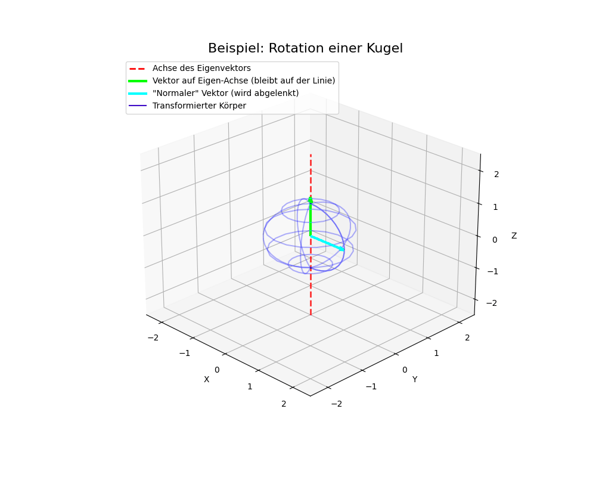

:::: {.content-visible when-profile="deutsch"}

## 7.3.1. Eigenvektoren sichtbar machen

Wir haben gelernt, dass Eigenvektoren die richtungsinvarianten Vektoren einer linearen Abbildung sind. Die folgende Animation zeigt dieses Prinzip anhand von drei eindrücklichen Beispielen.

:::{.callout-tip title="Was bedeuten die Farben in der Animation?" collapse="true"}
In jeder Szene siehst du:

*   Die **rote, gestrichelte Linie**: Die Richtung eines wichtigen Eigenvektors der Transformation.
*   Den **grünen Vektor** (lime): Ein Vektor, der genau auf dieser Eigen-Achse startet.
*   Den **türkisen Vektor** (cyan): Ein "normaler" Vektor, der nicht auf der Achse liegt.
*   Den **blauen Körper**: Eine Kugel oder ein Würfel, der transformiert wird.

Beobachte, wie sich der grüne und der türkise Vektor im Vergleich verhalten!
:::



Für eine detaillierte Beschreibung der einzelnen Transformationen klappe den folgenden Abschnitt auf.

:::{.callout-note title="Die drei Beispiele im Detail" collapse="true"}

::: {.callout-tip title="1. Rotation einer Kugel" collapse="true"}
Hier wird eine Einheitskugel um die Z-Achse gedreht. Man sieht, dass der grüne Vektor auf der Rotationsachse (der Z-Achse) stabil bleibt, während der türkise Vektor mit der Kugel mitrotiert wird. Die Rotationsachse ist somit der Eigenvektor der Transformation mit dem Eigenwert 1.

*   **Startkörper:** Eine Einheitskugel
*   **Transformationsmatrix (90°-Drehung):** $$ R = \begin{pmatrix} 0 & -1 & 0 \\ 1 & 0 & 0 \\ 0 & 0 & 1 \end{pmatrix} $$
*   **Gezeigter Eigenvektor (Rotationsachse):** $$ \textcolor{red}{\vec{v} = \begin{pmatrix} 0 \\ 0 \\ 1 \end{pmatrix}} $$
:::

::: {.callout-tip title="2. Skalierung eines Würfels" collapse="true"}
Ein Einheitswürfel wird entlang der Hauptachsen gestreckt und gestaucht. Der grüne Vektor liegt auf der X-Achse und wird nur in seiner Länge verändert. Der diagonale, türkise Vektor hingegen ändert seine Richtung. Dies zeigt, dass die Hauptachsen (X, Y, Z) die Eigenvektoren sind, entlang derer die Transformation als reine Skalierung wirkt.

*   **Startkörper:** Ein Einheitswürfel
*   **Transformationsmatrix (Skalierung):** $$ S = \begin{pmatrix} 2.0 & 0 & 0 \\ 0 & 0.5 & 0 \\ 0 & 0 & 1.5 \end{pmatrix} $$
*   **Gezeigter Eigenvektor (X-Achse):** $$ \textcolor{red}{\vec{v} = \begin{pmatrix} 1 \\ 0 \\ 0 \end{pmatrix}} $$
:::

::: {.callout-tip title="3. Scherung eines Würfels" collapse="true"}
Ein Würfel wird wie ein Kartenstapel seitlich verschoben (geschert). Der grüne Vektor liegt auf der unbewegten X-Achse und bleibt daher stabil. Der türkise Vektor, der in die Y-Richtung zeigt, wird durch die Scherung "umgeknickt". Die unbewegte Gleitrichtung (hier die X-Achse) ist also ein Eigenvektor.

*   **Startkörper:** Ein Einheitswürfel
*   **Transformationsmatrix (Scherung):** $$ H = \begin{pmatrix} 1 & 1 & 0 \\ 0 & 1 & 0 \\ 0 & 0 & 1 \end{pmatrix} $$
*   **Gezeigter Eigenvektor (X-Achse):** $$ \textcolor{red}{\vec{v} = \begin{pmatrix} 1 \\ 0 \\ 0 \end{pmatrix}} $$
:::

:::


Eigenvektoren zeigen also die Richtungen, in denen eine Transformation nur streckt. Gibt es genug davon (bei symmetrischen Matrizen ist das immer so), nennt man sie die **Hauptachsen** der Transformation: Betrachtet man den Raum entlang dieser Achsen, wird aus einer komplizierten Transformation eine einfache Streckung. Die Scherung und die Rotation oben zeigen, dass das nicht immer geht: Dort gibt es zu wenige Eigenrichtungen.

### 7.3.1.1. Selbst ausprobieren: eine Animation in 2D

Animationen laufen auch direkt hier im Browser. Die folgende Zelle wendet die Matrix $A = \begin{pmatrix} 2 & 1 \\ 1 & 2 \end{pmatrix}$ aus [7.1](eigenwerte_konzept.qmd) schrittweise auf den Einheitskreis an: Sie geht in kleinen Schritten von der Einheitsmatrix („nichts tun“) zu $A$. Die Farben sind dieselben wie oben: Der grüne Eigenvektor bleibt auf der roten Eigen-Achse und wird nur länger, der türkise Vektor kippt. Nach dem Ausführen erscheint ein Player mit Start/Stopp (die Berechnung dauert ein paar Sekunden).

```{pyodide-python}
import numpy as np
import matplotlib.pyplot as plt
from matplotlib.animation import FuncAnimation

A = np.array([
    [2, 1],
    [1, 2]
])
eigenwerte, eigenvektoren = np.linalg.eig(A)

v_eigen = eigenvektoren[:, np.argmax(eigenwerte)]   # Eigenvektor zum größten Eigenwert
v_normal = np.array([1.0, 0.0])                     # ein "normaler" Vektor
winkel = np.linspace(0, 2 * np.pi, 100)
kreis = np.vstack([np.cos(winkel), np.sin(winkel)])  # Einheitskreis als 2×100-Matrix

fig, ax = plt.subplots(figsize=(5, 5))
ax.set_xlim(-3.5, 3.5)
ax.set_ylim(-3.5, 3.5)
ax.set_aspect("equal")
ax.grid(True, alpha=0.3)
for s in eigenvektoren.T:                            # Eigen-Achsen als rote Linien
    ax.plot([-4 * s[0], 4 * s[0]], [-4 * s[1], 4 * s[1]], "r--", lw=1)
form, = ax.plot([], [], color="tab:blue")
pfeil_eigen = ax.quiver(0, 0, 0, 0, angles="xy", scale_units="xy", scale=1, color="limegreen", zorder=3)
pfeil_normal = ax.quiver(0, 0, 0, 0, angles="xy", scale_units="xy", scale=1, color="c", zorder=3)

def update(schritt):
    t = schritt / 30
    M = (1 - t) * np.eye(2) + t * A   # schrittweise von der Einheitsmatrix zu A
    k = M @ kreis
    form.set_data(k[0], k[1])
    pfeil_eigen.set_UVC(*(M @ v_eigen))
    pfeil_normal.set_UVC(*(M @ v_normal))
    ax.set_title(f"t = {t:.2f}")
    return form, pfeil_eigen, pfeil_normal

ani = FuncAnimation(fig, update, frames=31, interval=100)
plt.show()
```

Ändere `A` zum Beispiel in die Scherung `[[1, 1], [0, 1]]` oder die Spiegelung `[[1, 0], [0, -1]]` und beobachte, welche Vektoren jetzt auf ihrer Achse bleiben.

## 7.3.2. Wozu braucht man Eigenwerte & Eigenvektoren in der Praxis?

Die Konzepte der Eigenwerte und Eigenvektoren sind nicht nur von theoretischem Interesse, sondern bilden die Grundlage für zahlreiche Algorithmen und Technologien, die unseren digitalen Alltag prägen. Im Folgenden werden zwei prominente Beispiele vorgestellt.

### 7.3.2.1. Googles PageRank-Algorithmus
Die ursprüngliche Idee hinter der Google-Suche war, die "Wichtigkeit" einer Webseite zu quantifizieren. Die Definition war rekursiv: "Eine Webseite ist wichtig, wenn andere wichtige Webseiten auf sie verlinken."

Dieses Problem lässt sich elegant als Eigenwertproblem formulieren:

*   Man modelliert das gesamte Internet als eine gigantische Matrix $G$ (die "Google-Matrix"), in der die Einträge die Link-Struktur repräsentieren.
*   Gesucht wird ein Vektor $r$ (der PageRank-Vektor), dessen Einträge die Wichtigkeit jeder Seite angeben. Dieser Vektor soll stabil unter der Link-Transformation bleiben, d.h. $G \cdot r = r$.
*   Dies ist exakt die Eigenwertgleichung $G \cdot r = \lambda \cdot r$ für den **Eigenwert $\lambda = 1$**. Der gesuchte PageRank-Vektor ist also der **Eigenvektor zum Eigenwert 1** der Google-Matrix.

Die Berechnung dieses speziellen Eigenvektors war einer der Schlüssel zum Erfolg von Google.

### 7.3.2.2. Hauptkomponentenanalyse (PCA) zur Datenreduktion
In der Datenanalyse und im maschinellen Lernen hat man oft Datensätze mit sehr vielen Dimensionen (Features). Die Hauptkomponentenanalyse (PCA) ist ein Standardverfahren, um diese Komplexität zu reduzieren, ohne wesentliche Informationen zu verlieren.

*   Die PCA berechnet die Kovarianzmatrix der Daten. Diese Matrix beschreibt, wie die verschiedenen Features miteinander variieren.
*   Die **Eigenvektoren** dieser Kovarianzmatrix sind die "Hauptkomponenten". Sie definieren ein neues Koordinatensystem, dessen Achsen genau in die Richtungen der größten Varianz (Streuung) der Daten zeigen.
*   Die zugehörigen **Eigenwerte** geben an, wie viel Varianz entlang der jeweiligen Hauptkomponente liegt. Ein großer Eigenwert bedeutet eine wichtige Richtung.

Indem man nur die Eigenvektoren mit den größten Eigenwerten behält, kann man die Daten in einen kleineren Raum projizieren und dabei den Informationsverlust minimieren. Dies ist die Grundlage für viele Anwendungen, von der Gesichtserkennung („Eigenfaces“) bis zur Visualisierung hochdimensionaler Daten.

### Kurzes Quiz

```quizdown
---
locale: de
---

# Was passiert mit einem Eigenvektor $\vec{v}$, wenn man die Matrix $A$ auf ihn anwendet?
1. [ ] Er wird in eine völlig andere Richtung gedreht.
1. [x] Er wird nur um den Eigenwert $\lambda$ gestreckt oder gestaucht, seine Gerade bleibt gleich.
1. [ ] Er wird zum Nullvektor.
1. [ ] Er bleibt immer exakt unverändert.

> $A\vec{v} = \lambda\vec{v}$: Die Richtung bleibt auf derselben Geraden (bei negativem $\lambda$ mit umgekehrtem Richtungssinn).

# Was sind bei der PCA die Hauptkomponenten?
1. [ ] Die Zeilen der Datenmatrix.
1. [x] Die Eigenvektoren der Kovarianzmatrix der Daten.
1. [ ] Die Determinanten der Features.
1. [ ] Die Mittelwerte der Spalten.

> Sie zeigen in die Richtungen der größten Streuung der Daten.

# Was bedeutet ein großer Eigenwert bei der PCA?
1. [ ] Die zugehörige Richtung ist unwichtig.
1. [x] Entlang der zugehörigen Hauptkomponente liegt viel Varianz, die Richtung ist wichtig.
1. [ ] Die Daten sind fehlerhaft.
1. [ ] Die Matrix ist nicht invertierbar.

> Behält man nur die Eigenvektoren zu den größten Eigenwerten, verliert man möglichst wenig Information.
```

Hiermit hast du das Tutorial **Matrizen mit Python** abgeschlossen. Zum Schluss gibt es noch eine [kleine Übersicht](../Kapitel_8/cheatsheet.qmd) über die Python-Funktionen, die du im Verlauf dieses Tutorials kennengelernt hast, und was sie machen.

::::

:::: {.content-visible when-profile="english"}

## 7.3.1. Making eigenvectors visible {#eigenvektoren-sichtbar-machen}

We have learned that eigenvectors are the direction-invariant vectors of a linear map. The following animation shows this principle with three impressive examples.

:::{.callout-tip title="What do the colors in the animation mean?" collapse="true"}
In each scene you see:

*   The **red, dashed line**: the direction of an important eigenvector of the transformation.
*   The **green vector** (lime): a vector that starts exactly on this eigen-axis.
*   The **turquoise vector** (cyan): a "normal" vector that does not lie on the axis.
*   The **blue body**: a sphere or a cube that is transformed.

Watch how the green and the turquoise vector behave in comparison!
:::


For a detailed description of the individual transformations, expand the following section.

:::{.callout-note title="The three examples in detail" collapse="true"}

::: {.callout-tip title="1. Rotation of a sphere" collapse="true"}
Here a unit sphere is rotated about the z-axis. You can see that the green vector on the axis of rotation (the z-axis) stays stable, while the turquoise vector rotates along with the sphere. The axis of rotation is therefore the eigenvector of the transformation with eigenvalue 1.

*   **Starting body:** a unit sphere
*   **Transformation matrix (90° rotation):** $$ R = \begin{pmatrix} 0 & -1 & 0 \\ 1 & 0 & 0 \\ 0 & 0 & 1 \end{pmatrix} $$
*   **Eigenvector shown (axis of rotation):** $$ \textcolor{red}{\vec{v} = \begin{pmatrix} 0 \\ 0 \\ 1 \end{pmatrix}} $$
:::

::: {.callout-tip title="2. Scaling of a cube" collapse="true"}
A unit cube is stretched and compressed along the main axes. The green vector lies on the x-axis and only its length changes. The diagonal, turquoise vector, on the other hand, changes its direction. This shows that the main axes (x, y, z) are the eigenvectors along which the transformation acts as a pure scaling.

*   **Starting body:** a unit cube
*   **Transformation matrix (scaling):** $$ S = \begin{pmatrix} 2.0 & 0 & 0 \\ 0 & 0.5 & 0 \\ 0 & 0 & 1.5 \end{pmatrix} $$
*   **Eigenvector shown (x-axis):** $$ \textcolor{red}{\vec{v} = \begin{pmatrix} 1 \\ 0 \\ 0 \end{pmatrix}} $$
:::

::: {.callout-tip title="3. Shear of a cube" collapse="true"}
A cube is pushed sideways like a stack of cards (sheared). The green vector lies on the unmoved x-axis and therefore stays stable. The turquoise vector, which points in the y-direction, is "bent over" by the shear. The unmoved sliding direction (here the x-axis) is therefore an eigenvector.

*   **Starting body:** a unit cube
*   **Transformation matrix (shear):** $$ H = \begin{pmatrix} 1 & 1 & 0 \\ 0 & 1 & 0 \\ 0 & 0 & 1 \end{pmatrix} $$
*   **Eigenvector shown (x-axis):** $$ \textcolor{red}{\vec{v} = \begin{pmatrix} 1 \\ 0 \\ 0 \end{pmatrix}} $$
:::

:::


Eigenvectors therefore show the directions in which a transformation only stretches. If there are enough of them (for symmetric matrices this is always the case), they are called the **principal axes** of the transformation: if you look at space along these axes, a complicated transformation becomes a simple stretching. The shear and the rotation above show that this is not always possible: there are too few eigendirections there.

### 7.3.1.1. Try it yourself: an animation in 2D {#selbst-ausprobieren-eine-animation-in-2d}

Animations also run directly here in the browser. The following cell applies the matrix $A = \begin{pmatrix} 2 & 1 \\ 1 & 2 \end{pmatrix}$ from [7.1](eigenwerte_konzept.qmd) step by step to the unit circle: it goes in small steps from the identity matrix ("do nothing") to $A$. The colors are the same as above: the green eigenvector stays on the red eigen-axis and only gets longer, the turquoise vector tilts. After running, a player with start/stop appears (the computation takes a few seconds).

```{pyodide-python}
import numpy as np
import matplotlib.pyplot as plt
from matplotlib.animation import FuncAnimation

A = np.array([
    [2, 1],
    [1, 2]
])
eigenvalues, eigenvectors = np.linalg.eig(A)

v_eigen = eigenvectors[:, np.argmax(eigenvalues)]   # eigenvector for the largest eigenvalue
v_normal = np.array([1.0, 0.0])                     # a "normal" vector
angle = np.linspace(0, 2 * np.pi, 100)
circle = np.vstack([np.cos(angle), np.sin(angle)])  # unit circle as a 2×100 matrix

fig, ax = plt.subplots(figsize=(5, 5))
ax.set_xlim(-3.5, 3.5)
ax.set_ylim(-3.5, 3.5)
ax.set_aspect("equal")
ax.grid(True, alpha=0.3)
for s in eigenvectors.T:                            # eigen-axes as red lines
    ax.plot([-4 * s[0], 4 * s[0]], [-4 * s[1], 4 * s[1]], "r--", lw=1)
shape, = ax.plot([], [], color="tab:blue")
arrow_eigen = ax.quiver(0, 0, 0, 0, angles="xy", scale_units="xy", scale=1, color="limegreen", zorder=3)
arrow_normal = ax.quiver(0, 0, 0, 0, angles="xy", scale_units="xy", scale=1, color="c", zorder=3)

def update(step):
    t = step / 30
    M = (1 - t) * np.eye(2) + t * A   # step by step from the identity matrix to A
    k = M @ circle
    shape.set_data(k[0], k[1])
    arrow_eigen.set_UVC(*(M @ v_eigen))
    arrow_normal.set_UVC(*(M @ v_normal))
    ax.set_title(f"t = {t:.2f}")
    return shape, arrow_eigen, arrow_normal

ani = FuncAnimation(fig, update, frames=31, interval=100)
plt.show()
```

Change `A`, for example, to the shear `[[1, 1], [0, 1]]` or the reflection `[[1, 0], [0, -1]]` and watch which vectors now stay on their axis.

## 7.3.2. What are eigenvalues & eigenvectors needed for in practice? {#wozu-braucht-man-eigenwerte-eigenvektoren-in-der-praxis}

The concepts of eigenvalues and eigenvectors are not only of theoretical interest, but form the basis for numerous algorithms and technologies that shape our digital everyday life. Two prominent examples are presented below.

### 7.3.2.1. Google's PageRank algorithm {#googles-pagerank-algorithmus}
The original idea behind Google search was to quantify the "importance" of a web page. The definition was recursive: "A web page is important if other important web pages link to it."

This problem can be formulated elegantly as an eigenvalue problem:

*   The entire internet is modeled as a gigantic matrix $G$ (the "Google matrix"), whose entries represent the link structure.
*   We are looking for a vector $r$ (the PageRank vector) whose entries give the importance of each page. This vector should remain stable under the link transformation, i.e. $G \cdot r = r$.
*   This is exactly the eigenvalue equation $G \cdot r = \lambda \cdot r$ for the **eigenvalue $\lambda = 1$**. The PageRank vector we are looking for is therefore the **eigenvector for eigenvalue 1** of the Google matrix.

Computing this special eigenvector was one of the keys to Google's success.

### 7.3.2.2. Principal component analysis (PCA) for data reduction {#hauptkomponentenanalyse-pca-zur-datenreduktion}
In data analysis and machine learning, one often has datasets with very many dimensions (features). Principal component analysis (PCA) is a standard method for reducing this complexity without losing essential information.

*   PCA computes the covariance matrix of the data. This matrix describes how the different features vary together.
*   The **eigenvectors** of this covariance matrix are the "principal components". They define a new coordinate system whose axes point exactly in the directions of the largest variance (spread) of the data.
*   The corresponding **eigenvalues** state how much variance lies along the respective principal component. A large eigenvalue means an important direction.

By keeping only the eigenvectors with the largest eigenvalues, the data can be projected into a smaller space while minimizing the loss of information. This is the basis for many applications, from face recognition ("eigenfaces") to the visualization of high-dimensional data.

### Short Quiz

```quizdown
---
locale: en
---

# What happens to an eigenvector $\vec{v}$ when the matrix $A$ is applied to it?
1. [ ] It is rotated into a completely different direction.
1. [x] It is only stretched or compressed by the eigenvalue $\lambda$, its line stays the same.
1. [ ] It becomes the zero vector.
1. [ ] It always stays exactly unchanged.

> $A\vec{v} = \lambda\vec{v}$: the direction stays on the same line (reversed in sense for negative $\lambda$).

# What are the principal components in PCA?
1. [ ] The rows of the data matrix.
1. [x] The eigenvectors of the covariance matrix of the data.
1. [ ] The determinants of the features.
1. [ ] The column means.

> They point in the directions of the largest spread of the data.

# What does a large eigenvalue mean in PCA?
1. [ ] The corresponding direction is unimportant.
1. [x] There is a lot of variance along the corresponding principal component, the direction is important.
1. [ ] The data are faulty.
1. [ ] The matrix is not invertible.

> If you keep only the eigenvectors with the largest eigenvalues, you lose as little information as possible.
```

With this you have completed the tutorial **Matrices with Python**. Finally, there is a [small overview](../Kapitel_8/cheatsheet.qmd) of the Python functions you have learned in the course of this tutorial and what they do.

::::
